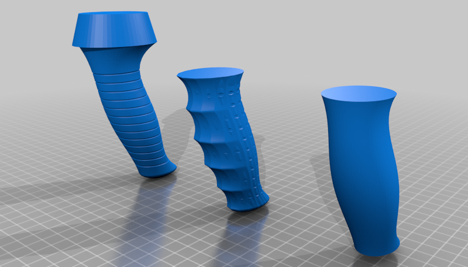
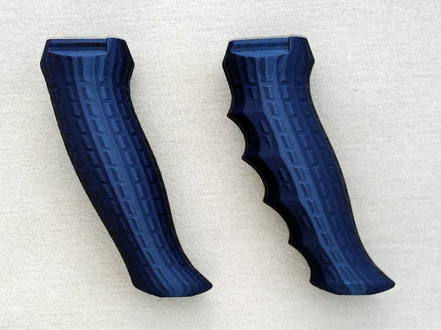
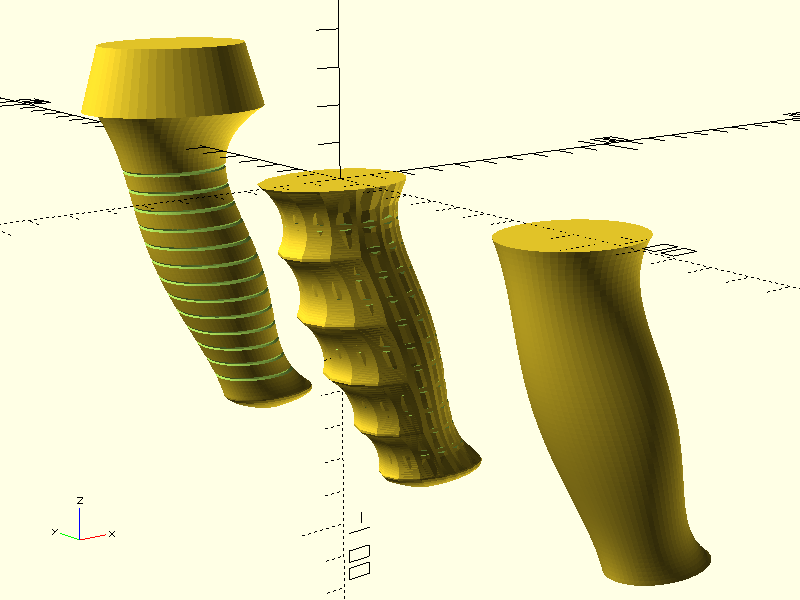
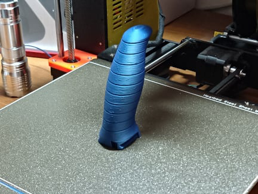
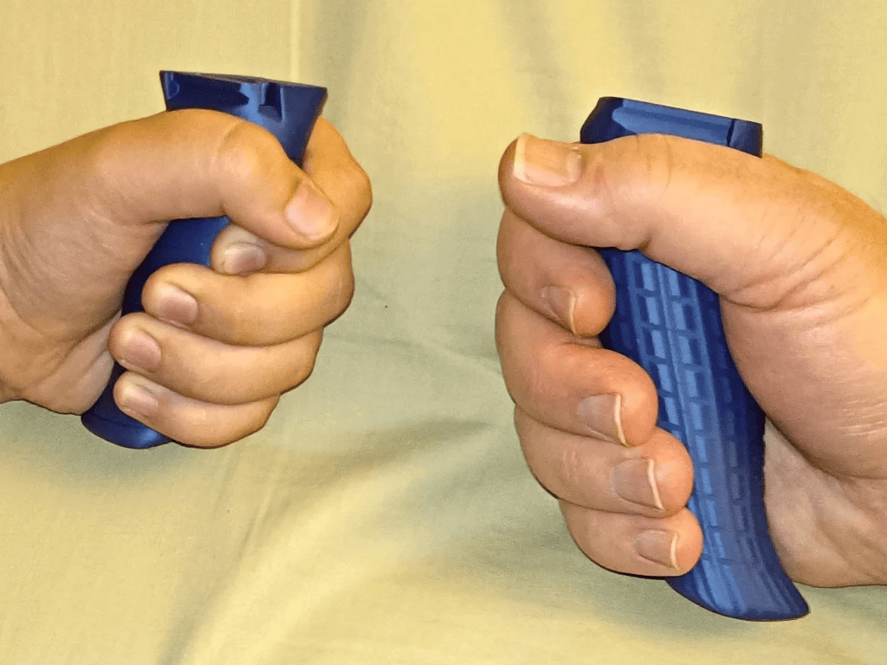

# Ergonomic Handle

An OpenSCAD library that generates an ergonomic handle, one that spreads hand
contact pressure as evenly as possible, scaled to any hand size.



It continues Alex Matulich's "Ergonomic handle based on scientific study"
([Thingiverse](https://www.thingiverse.com/thing:5330170),
[Printables](https://www.printables.com/model/154837)).

## Basis

The dimensions come from several research papers using anthropometric data
from populations around the world. The profile comes from a 2020 study in
which gripping hands were measured with a contour gauge to derive the curves
of an ergonomic handle. The studies are cited and linked in Alex's article
"[Whose hands are biggest? You may be surprised.](https://www.nablu.com/2022/03/whose-hands-are-biggest-you-may-be.html)"

The contour study is generalised to any hand: the handle's height follows
metacarpal breadth (hand width) and its cross-sections follow hand length, so
the study's curve control points can be scaled vertically and horizontally to
fit.



## Usage

Put `ergonomic_handle.scad` where your script can find it, such as beside it:

```openscad
use <ergonomic_handle.scad>

ergonomic_handle(hand_length = 178, hand_width = 79.4, bottomcapext = 6, groovespc = 6);
```

Opening `ergonomic_handle.scad` itself shows a handle driven by the
customizer; `ergonomic_handle.json` holds presets for it, and
`ergonomic_handle.csv` lists the same designs one per row for batch export.

## Modules

### `ergonomic_handle(...)`

Renders the handle body. The centre of the top surface is at the origin and
the bottom, not counting the bottom cap, is `ergonomic_handle_height()` below
it.



| Parameter              | Default | Meaning |
| ---------------------- | ------- | ------- |
| `hand_length`          | 186     | Tip of the middle finger to the first wrist crease, in mm. |
| `hand_width`           | 85      | Metacarpal breadth: width of the four fingers where they meet the palm, in mm. |
| `flair`                | `true`  | Flare the top and bottom of the front edge for better pull force. `false` gives the handle as the study describes it. |
| `bottomcapext`         | 0       | Bottom cap extension in mm; 0 is a flat bottom. Suggested: 3 to 8. |
| `topext`               | 0       | Extend the curves upward by this many mm, above the origin. |
| `groovespc`            | 0       | Spacing of grip grooves in mm; 0 is none. Suggested: 6 to 10. Ignored when `fingergroove` is on. |
| `fingergroove`         | `false` | Add finger grooves. The handle then fits only the hand it was sized for and is uncomfortable for others. |
| `tiltangle`            | 110     | Handle tilt in degrees. No less than 90. |
| `fn`                   | 64      | Facets around the cross-section and, without finger grooves, vertical slices. With finger grooves there are always 128 slices. |
| `halfrotate`           | `false` | Rotate the cross-section's vertices by half a segment. Useful for overlapping two low-facet handles into a texture. |
| `metacarpal_expansion` | 1.12    | How much metacarpal breadth grows in a grip. Values outside 1.10 to 1.15 are clamped to that range, with a warning. |
| `groovedepth`          | 0.6     | Depth of the grip grooves, in mm. |
| `bottomcapscale`       | 0.3     | Scale of the last cross-section of the bottom cap. |

### `ergonomic_handle_top_ellipse(...)`

A 2D polygon matching the top surface of the handle, including `topext`. Takes
`hand_length`, `hand_width`, `metacarpal_expansion`, `flair`, `fingergroove`,
`topext`, `tiltangle`, `fn` and `halfrotate`, with the same defaults as
`ergonomic_handle`. Pass the same values to both.

### `ergonomic_handle_bottom_ellipse(...)`

A 2D polygon matching the bottom surface of the handle, not counting the
bottom cap. Useful for matching something to a handle without a cap. Same
parameters as the top ellipse, without `topext`.

### `ergonomic_handle_height(hand_width, metacarpal_expansion)`

The height of the handle body without extensions: `hand_width` times
`metacarpal_expansion`, the latter clamped as above. Defaults to 85 and 1.12.

### `default_hand_length(female)` and `default_hand_width(female)`

The average hand: 186 by 85 mm, or 171 by 76 mm with `female = true`.

## Hand sizes

The defaults were calculated from journal data broken down by nationality:
Bangladeshi, Czech, Filipino, German, central Indian, East Indian, Iranian,
Korean, Jordanian, Mexican, Taiwanese, Turkish and Vietnamese. The average
male hand is 186 mm long (range 173 to 198) and 85 mm broad (range 78 to 98).
The average female hand is 76 mm broad (range 68 to 92), with lengths from 161
to 180 mm. The average male size should also suit nearly all adult women and
all children.

## Examples

- `examples/handle_no_grooves.scad`: a plain handle.
- `examples/grooved_handle_with_extension.scad`: grip grooves, a top
  extension, a bottom cap and a structure built on the top ellipse.
- `examples/low_facet_handle_with_grooves.scad`: two low-facet handles
  overlaid for texture.

## Printing



Print the handle upside-down and it needs no supports. Settings that have
worked: a Prusa i3 MK3S with 15% gyroid infill.

## Development

With [just](https://just.systems/), OpenSCAD and Python 3 installed,
`just test` renders the library, every example and every preset with OpenSCAD
warnings treated as errors.

## License and attribution

Creative Commons Attribution 4.0 International. See [LICENSE](LICENSE).

The design is by **Alex Matulich**, version 5.1 of May 2022, published on
[Thingiverse](https://www.thingiverse.com/thing:5330170) and described on his
[blog](https://www.nablu.com/2022/03/whose-hands-are-biggest-you-may-be.html).
The header of `ergonomic_handle.scad` notes the changes made here in November 2026.


